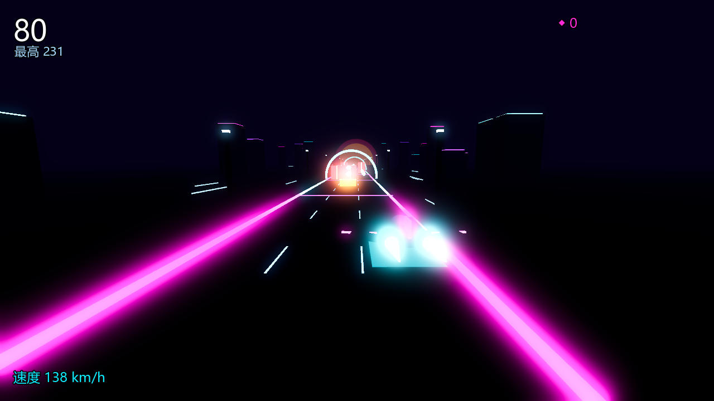

# NEON RUSH｜霓虹狂飙

一款以三车道躲避与跳跃为核心的 3D 霓虹无尽跑酷游戏：在不断加速的道路上闪避障碍、收集能量，尽可能刷新得分。



## 游戏玩法

- 使用 **← / →** 或 **A / D** 在三条车道间移动。
- 使用 **空格 / W / ↑** 跳跃。
- 避开道路上的障碍物，并收集能量方块；收集会增加分数。
- 游戏结束后，按 **R**、**空格**、**Enter** 或点击画面重新开始。
- 游戏显示当前分数、最高分与速度；最高分保存在本地 Godot 用户数据中。

## 画面与交互

场景以 GDScript 在运行时构建，呈现发光道路、几何障碍与霓虹色调。游戏包含随速度变化的镜头视野、变道倾斜、跳跃和碰撞反馈，以及 HUD 分数与速度信息。仓库内的 `qa/qa_0.png` 至 `qa/qa_3.png` 是现有游戏画面，可用于查看不同状态。

音频素材位于 `assets/`，包括循环背景音乐及拾取、跳跃、变道和碰撞音效；`tools/gen_audio.py` 提供对应的 WAV 合成脚本。

## 技术栈

- Godot Engine 4.7，GDScript
- 3D 场景与游戏逻辑：`main.gd`；主场景：`main.tscn`
- Godot 工程配置与运行入口：`project.godot`
- 音频素材：`assets/*.wav`；生成脚本：`tools/gen_audio.py`

## 本地运行

需要安装 **Godot 4.7**。在仓库根目录运行：

```bash
godot --path .
```

项目配置将 `main.tscn` 设为主场景。仓库包含名为 `Windows` 的 Windows Desktop 导出预设（见 `export_presets.cfg`）；实际导出还需要可用的 Godot 导出模板。

## 项目文件

```text
main.gd             游戏逻辑、运行时场景与界面
main.tscn           主场景
project.godot       Godot 项目配置
assets/             背景音乐与游戏音效
qa/                 已有游戏画面
tools/gen_audio.py 音频 WAV 合成脚本
export_presets.cfg  Windows Desktop 导出预设
```
