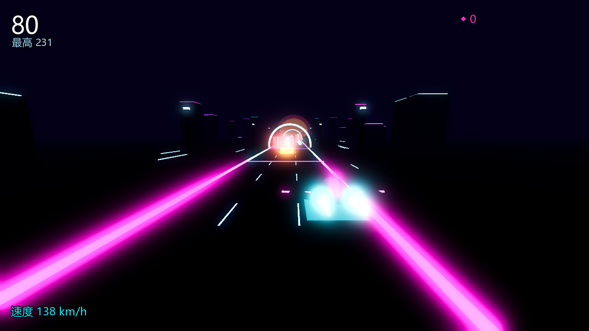

# NEON RUSH · 霓虹狂飙

> 一款 3D 霓虹风无尽狂飙游戏。Godot 4.7 引擎打造，**全部场景、模型、音效均为程序化生成**——仓库里没有一张图片、没有一个音频文件，所有视觉与听觉都是代码实时合成的。



## 玩法

- **←/→ 或 A/D**：三车道切换
- **SPACE / W / ↑**：跳跃（可跳过低栏，低栏上方常有能量奖励）
- **R**：结束后重开
- 躲开红色路障、收集青色能量方块（+30 分）、贴近路障擦过有 **"贴脸 +15"** 奖励
- 速度随时间不断攀升（127 → 378 km/h），看你能撑多远

## 特性

- **零素材**：玩家飞船、霓虹道路、拱门、落日、城市天际线全部由 GDScript 运行时构建；BGM 是一段程序合成的 112 BPM synthwave 循环，音效（拾取/跳跃/变道/撞毁）全部 WebAudio 式数字合成，由 `tools/gen_audio.py` 生成 WAV
- **Godot 4.7 Forward+ 渲染**：Bloom 辉光、雾、ACES 色调映射、MSAA
- **手感细节**：变道侧倾、速度镜头 FOV 拉伸、撞击慢动作 + 屏幕震动、贴脸奖励飘字
- **单文件发行**：`build/NEON-RUSH.exe`（约 110MB，PCK 内嵌，双击即玩）

## 本地运行

```bash
# 编辑器运行（需 Godot 4.7+）
godot --path .

# 导出 Windows 单文件 exe
godot --headless --path . --export-release "Windows" build/NEON-RUSH.exe
```

## 技术结构

```
main.gd            全部游戏逻辑与场景构建（约 700 行）
main.tscn          入口场景（仅挂 main.gd）
project.godot      Godot 4.7 工程配置
assets/*.wav       程序化生成的音频（构建产物，可由 tools/gen_audio.py 重新生成）
tools/gen_audio.py 音频合成器（纯 Python 标准库）
export_presets.cfg Windows 导出预设
```

## 设计说明

- 撞击判定为逻辑判定（车道距离 + 高度窗口），不依赖物理引擎，稳定且可预测
- 障碍生成保证**永远留一条活路**；双障碍时活路频道会刷能量线引导走位
- 拱门接近相机时自动隐藏，避免穿模糊屏
- 最高分持久化在 `user://neonrush.dat`
- 预留 `assets/player.glb` 接口：放入文件即自动替换程序化飞船（可用于 Blender 建模升级）
